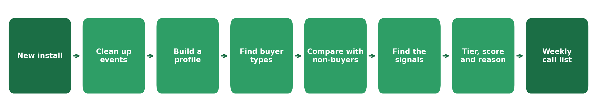
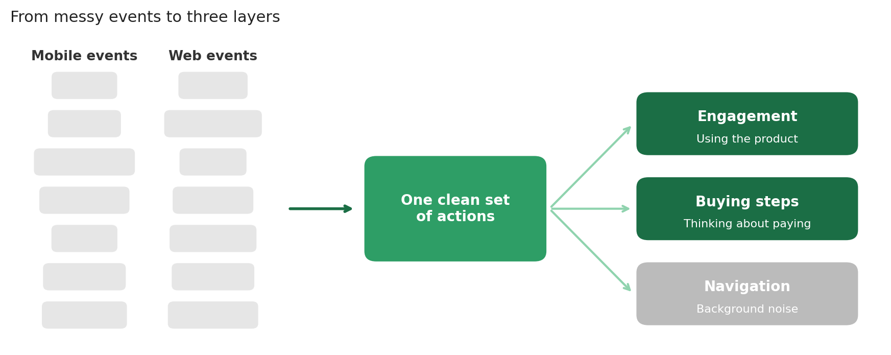
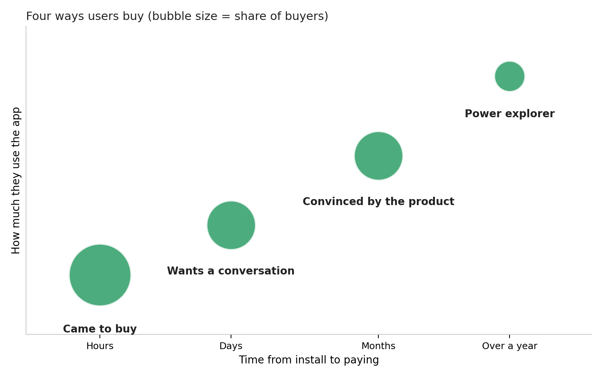
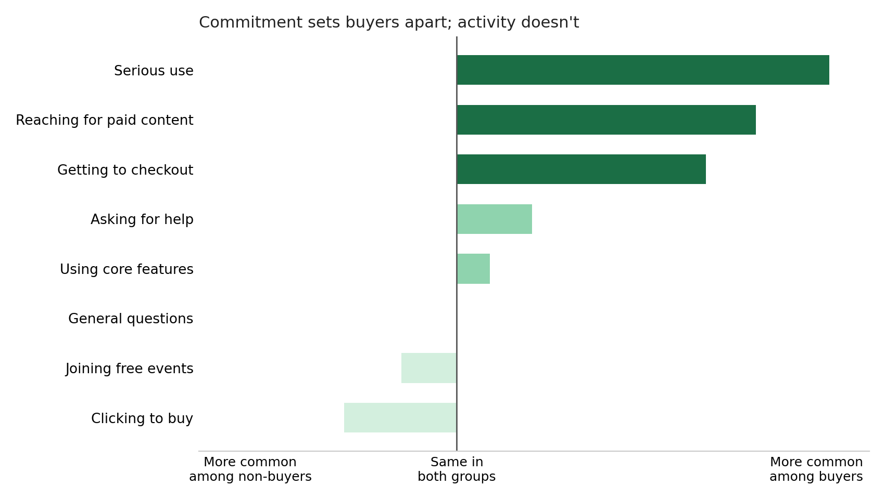
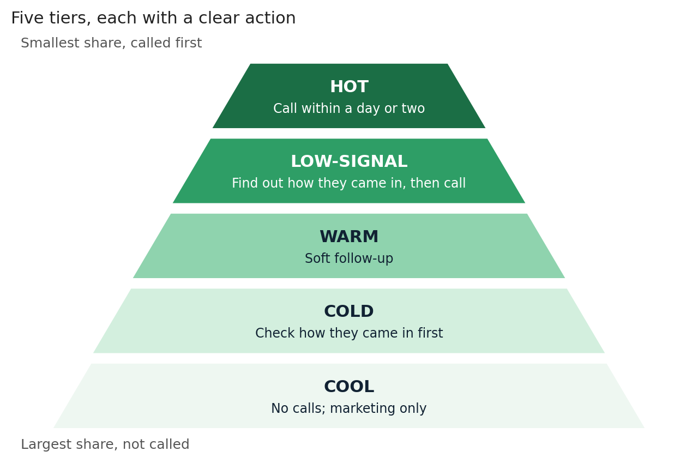

# How the high-intent scoring works

*A case study on how new installs behave across the mobile and web app, what buyers do differently from everyone else, and how those differences became a way to spot likely buyers early.*

New users install the app every day, on mobile and on web, and most of them never pay. We needed to understand what those new installs were actually doing: what they opened, what they tried, and how far they got before they either paid or drifted off. The question was: from app activity alone, can we tell which new installs are likely to pay, and which actions show it most reliably? The [README](../README.md) has the full background. This covers how the scoring was built.

---

## What each install ends up with

By the end, every new install gets four things:

| Field | Description |
| --- | --- |
| Tier | The recommended follow-up |
| Buyer type | The behaviour pattern it most closely matches |
| Priority score | Its position within the tier |
| Reason | A short, plain-language explanation of why it was flagged |

Getting there started with deciding what to compare.

---

## How I approached it

Looking only at users who paid would show what buyers do, but not whether it sets them apart. So I worked with two groups, using everything they did on the mobile and web app:

- **Users who paid**, with their full journey from install to payment
- **Users who didn't pay**, who installed over the same months, chose the same exam, and had at least a month to buy

If both groups do something, it can't tell us who will pay. Only actions that buyers do much more often are worth acting on.

There was no data on how users found the app, so everything had to come from behaviour alone. That set the plan:

1. Learn from users who had already paid.
2. Check what I learned against users who hadn't.
3. Try it on new installs, week by week.

Before any of that, the data had to be readable.

---

## Step 1: Make the data readable

Raw event data is rarely ready to use, so I started by cleaning it up:

- matched events that meant the same thing but were logged differently on mobile and web
- merged them into one consistent set of actions
- tagged every event by platform, so mobile and web activity could be compared
- separated real actions from navigation and background noise

Then I sorted the actions by what they say about intent. Using the product, thinking about paying, and just moving around the app tell you very different things, so each action went into one of three layers:

| Layer | Examples | Meaning |
| --- | --- | --- |
| Engagement | Using the product's main features | They're using the product |
| Buying steps | Checking prices, hitting a paywall, starting checkout, asking for help | They're thinking about paying |
| Navigation | Opening screens, signing in, browsing menus | Background noise |

With the actions cleaned and grouped, each user could be described the same way.

---

## Step 2: Describe each user

For every user who paid, I counted:

- what they did in each group of actions
- how many different things they tried
- how many days they were active
- how their activity split between engagement, buying steps and web

Some users did very little before paying, and others did a huge amount. To stop the heaviest users from skewing the results, I scaled the counts so every user could be compared fairly. I built the same profile for every non-buyer, so the two groups could be compared later.

Then came the next question: do buyers fall into a few clear patterns?

---

## Step 3: Look for patterns among buyers

I grouped paying users by how they behaved before buying: how much they used the app, what kinds of actions they took, how varied their activity was, and how many days they stayed active. Four clear patterns came out of that. Each one behaved differently and was large enough to trust. The groups also turned out to take very different amounts of time to pay.

| Buyer type | Share of buyers | Typical time to pay | What they do |
| --- | --- | --- | --- |
| Came to buy | About 4 in 10 | Hours | Barely use the app, then pay, often in the first session |
| Wants a conversation | About a quarter | A few days | Try a little, ask for help, then pay |
| Convinced by the product | About a quarter | A few months | Use the product properly before deciding |
| Power explorer | About 1 in 10 | Over a year | Use everything heavily for a long time before paying |

These are snapshots, not fixed labels. A user who keeps using the product can move from one type to another, and a new install's type only settles after the first few days.

The buyer types showed how people buy. They didn't show whether those behaviours set buyers apart, because so far I had only looked at buyers.

---

## Step 4: Check against users who didn't pay

A behaviour that's common among buyers isn't necessarily a sign of buying. It might just be something everyone does. So for every behaviour, I compared how often buyers did it with how often non-buyers did.

That check changed the answer. Asking for help looked like a strong signal when I only looked at buyers, because many of them did it. But plenty of non-buyers did it too, so on its own it said very little.

Only behaviours that were clearly more common among buyers were kept as signals. That's what the next step looks at.

---

## Step 5: Find the signals that matter

With the comparison in place, a behaviour only counted if it clearly beat the average.

My starting idea was that a real signal shows commitment, not just activity. Using the app is easy and costs nothing. What I was looking for were actions where a user puts in real effort or moves towards paying.

Three kinds of behaviour held up, each making a user roughly twice as likely to pay:

- **Serious use:** going deep into the product rather than just trying it
- **Reaching for paid content:** trying to open something only paying users get
- **Getting to checkout:** starting to pay, then stopping before finishing

Even these aren't guarantees. About 9 in 10 users who show one still don't pay. A flagged user is about twice as likely to buy, not certain to.

The bigger lesson was in what didn't hold up. Many actions that sound like intent were just as common among non-buyers:

- **Clicking to buy** often meant seeing the price and leaving
- **Joining free events** was curiosity, not commitment
- **Asking for help**, as Step 4 showed, said little on its own
- **General browsing** happened at the same rate in both groups

So the rule I ended up with was simple: activity shows interest; commitment shows a likely buyer. That gave me something to act on.

---

## Step 6: Turn signals into action

Step 5 left three signals and four buyer types. To make them usable, I turned them into five tiers, each with a clear action:

| Tier | Who | Action |
| --- | --- | --- |
| HOT | Shows one of the three commitment signals, or looks like a power explorer | Call within a day or two |
| LOW-SIGNAL | Signed up but did almost nothing, like the came-to-buy group | Find out how they came in, then call quickly |
| WARM | Some interest in paying, but no strong signal | Soft follow-up |
| COLD | Low activity that doesn't match the came-to-buy group | Check how they came in before calling |
| COOL | Browsing only | No calls; marketing only |

Power explorers are also HOT: users who matched that pattern converted at the highest rate of any group. LOW-SIGNAL exists because of Step 3. Users who came to buy barely use the app, so a quiet new install isn't necessarily a lost one.

Within each tier, a priority score sets the order:

- the strongest signals score highest, with getting to checkout first
- smaller signs of interest add a little
- recent activity adds more

Every user also gets a reason line, so the person calling knows why, for example: "Installed 3 days ago, active today. Used the product seriously several times. Users who do this pay at about twice the usual rate. Follow up within two days."

With tiers, scores and reasons in place, it was ready to run on real installs.

---

## Step 7: Run it every week

Each week, the tiers were applied to new installs that hadn't paid:

- a small share came out HOT
- more than half came out COOL and were left out of calls
- as exam season got closer, more HOT users showed up through serious preparation rather than checkout, as they started studying

Running it week after week also showed where the method falls short.

---

## Limitations

- The two groups weren't measured over the same window. Buyers' activity stops when they pay, while non-buyers had at least a month to do anything. That can make some behaviours look less useful than they are. Comparing both groups over the same first days after install would fix it.
- The biggest buyer type is invisible. Users who came to buy barely use the app, so behaviour alone can't spot them. That needs data on how they found the app.
- No record of follow-up outcomes. I couldn't see whether a user who asked for help was actually reached, or what closed them.
- Too early to judge live results. It was off-season, so very few flagged users had a chance to buy.
- The smallest group is rough. Power explorers were a small share of buyers, so their thresholds are approximate, though the pattern holds.

---

## Takeaways

- Compare against non-buyers. Several "signals" only looked real until I saw how often non-buyers did the same thing.
- Look for commitment, not activity. Effort and steps towards paying predicted buying. Browsing didn't.
- A lot of buying starts outside the app. About 4 in 10 buyers paid almost straight away, so something before the app likely sold them. That's the biggest gap left.

---

*Note: Company details, product features and figures are generalised. The approach and findings are from the actual analysis.*
